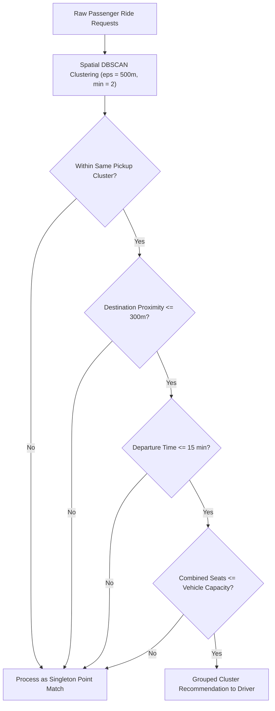

# AI Commuter Assistant Design Specification (Module 5: FR5.1 & FR5.2)

> **Module:** Module 5 — AI Commuter Assistant & Carbon Dashboard  
> **Requirement IDs:** FR5.1 (Natural-Language Ride Request Parser), FR5.2 (Intelligent Passenger Grouping & Recommendation)  
> **Author:** Member 4 (AI Developer, Group 9 - FOPGang, WIA2007)  
> **Status:** Phase 2 Architecture & Design Specification (Sprint 1)

---

## 1. Executive Summary & Design Principles

Module 5 provides the intelligent automation layer for UMPooling:
1. **FR5.1 Natural-Language Parser:** Converts informal speech and text queries into structured ride requests so commuters can post requests effortlessly.
2. **FR5.2 Passenger Grouping Spec:** Uses spatial clustering (DBSCAN) and multi-factor rule compatibility filtering to aggregate student commuters living in the same off-campus residential clusters into high-occupancy carpools.
3. **Safety & Zero-Hallucination Policy:** Under no circumstances will the AI silently guess or fabricate missing origin, destination, or time data. Missing or ambiguous entities are explicitly surfaced to the user for manual confirmation in the Compose form.

---

## 2. FR5.1: Natural-Language Ride Request Parser

### 2.1 System Architecture & Data Flow
The parser operates as a secure Supabase Edge Function (`supabase/functions/parse-ride-request/index.ts`) written in TypeScript/Deno. The mobile client submits the raw utterance along with device reference time, and receives a validated JSON payload:

```
[Android Client: VoiceRequestScreen]
       │
       ▼ (Raw query string + local reference timestamp)
[Supabase Edge Function: parse-ride-request]
       │
       ├── Input Sanity & Guardrails (Length 1..500 chars, Prompt Injection Scrubbing)
       │
       ▼ (Structured prompt with UM Lexicon)
[LLM Provider: Gemini 1.5 Flash / OpenRouter (Server-Side Key)]
       │
       ▼ (Strict JSON payload)
[Edge Post-Processor & UM Zone Lexicon Mapper (locations.json)]
       │
       ▼ (Validated JSON with confidence & missing/ambiguous flags)
[Android Client: RideParserRepository -> Request Form Pre-fill]
```

### 2.2 System Prompt Specification (`parser prompt v0`)
```text
You are an expert transportation AI parsing Malaysian university carpooling ride requests for Universiti Malaya (UM).
Given a user query and reference timestamp, extract the commuting intent into a strictly conforming JSON object.

# Reference Time:
Current Local Time: {{CURRENT_DATETIME}} (Asia/Kuala_Lumpur, UTC+8)

# Domain Knowledge (UM Campus & Student Enclaves):
- Off-Campus Student Residential Zones: Tiara Damansara, Astana Damansara, Prima 16, Li Villas, Pacific Star, Ryan & Miho, Jaya One, Atwater, PJ Midtown, University Tower, Section 11, Section 17, Vista Angkasa, KL Gateway, Residensi Kerinchi, South View, South Link, Novum, Pantai Hillpark, Bangsar South.
- On-Campus Colleges: KK1 through KK13 (e.g., Kolej Kediaman 12 / KK12 / Raja Dr. Nazrin Shah).
- Faculties & Academies: FSKTM (FCSIT / Computer Science), Engineering, Science, Medicine, Law, FBEc (Economics), Arts (FASS), Education, Built Environment, Pharmacy, Dentistry, Business.
- Landmarks: Main Library (Perpustakaan Utama), DTC (Dewan Tunku Canselor), Examination Building (Peperiksaan), Pusat Sukan / UM Arena, UMMC (PPUM), Masjid Ar-Rahman.

# Extraction Rules:
1. "origin": Identify the pickup zone or landmark. If ambiguous or missing, set null.
2. "destination": Identify the drop-off zone or faculty. If ambiguous or missing, set null.
3. "departure_date": Output in ISO-8601 "YYYY-MM-DD" format relative to reference time (resolve "tomorrow", "esok", "today", "hari ini", "next Monday"). If unspecified, default to reference date.
4. "departure_time": Output in 24-hour "HH:mm" format (resolve "8:30am" -> "08:30", "pagi esok pukul 8" -> "08:00", "petang ni kul 5" -> "17:00"). If unspecified, set null.
5. "seats": Number of passenger seats needed (integer, default 1).
6. "missing_fields": Array of missing essential fields: ["origin", "destination", "departure_time"].
7. "ambiguous_fields": Array of fields where multiple conflicting interpretations exist.
8. "confidence": Floating point score between 0.0 and 1.0.

# Zero-Hallucination Mandate:
NEVER guess an origin or destination if not mentioned. If the user only says "I need a ride at 9am", flag ["origin", "destination"] in missing_fields.

Return raw JSON only, enclosed in ```json ... ``` without extra commentary.
```

### 2.3 Strict Output JSON Schema
```json
{
  "$schema": "http://json-schema.org/draft-07/schema#",
  "type": "object",
  "properties": {
    "origin": { "type": ["string", "null"] },
    "destination": { "type": ["string", "null"] },
    "departure_date": { "type": ["string", "null"], "pattern": "^\\d{4}-\\d{2}-\\d{2}$" },
    "departure_time": { "type": ["string", "null"], "pattern": "^\\d{2}:\\d{2}$" },
    "seats": { "type": "integer", "minimum": 1, "maximum": 6 },
    "missing_fields": {
      "type": "array",
      "items": { "type": "string", "enum": ["origin", "destination", "departure_date", "departure_time", "seats"] }
    },
    "ambiguous_fields": {
      "type": "array",
      "items": { "type": "string" }
    },
    "confidence": { "type": "number", "minimum": 0.0, "maximum": 1.0 },
    "raw_query": { "type": "string" }
  },
  "required": ["origin", "destination", "departure_time", "seats", "missing_fields", "confidence"],
  "additionalProperties": false
}
```

### 2.4 Client-Side Fallback & UI Validation
When the Android client receives the parsed response:
1. If `missing_fields` or `ambiguous_fields` is non-empty, the corresponding form inputs in Compose are flagged with an amber outline and assistive hint (e.g., *"Please select your destination"*).
2. If network fails, API returns an error, or confidence $< 0.40$, the app displays a soft warning toast: *"Could not fully parse speech. Please complete the form below."* and populates whatever partial tokens were recovered.
3. The user must always press the physical **"Confirm & Request Ride"** button before any database row is committed.

---

## 3. FR5.2: Passenger Grouping Design Specification

### 3.1 Motivation & Campus Commuter Topology
Off-campus UM students are concentrated in dense geographic pockets within 3–8 km of campus:
* **Northern Corridor:** Tiara Damansara, Astana Damansara, Prima 16, Section 17, Pacific Star.
* **Southern / Federal Highway Corridor:** Vista Angkasa, Residensi Kerinchi, South View, Pantai Hillpark, Bangsar South.

Drivers face severe detour penalties if picking up passengers scattered across disparate neighborhoods. FR5.2 clusters nearby passenger requests into shared pickup nodes (e.g. guardhouse lobbies, LRT station bays) to maximise vehicle occupancy while keeping detour times under 8 minutes.

### 3.2 Clustering Algorithm: DBSCAN on Haversine Distance
UMPooling utilises **Density-Based Spatial Clustering of Applications with Noise (DBSCAN)**:
* **Spatial Metric:** Great-circle Haversine distance between pickup coordinates $(lat_1, lon_1)$ and $(lat_2, lon_2)$.
* **Core Parameters:**
  - $\varepsilon$ (Epsilon neighborhood radius): **$0.50\text{ km}$** ($500\text{ metres}$). Matches the walkable catchment of student apartment clusters.
  - $\text{min\_samples}$ (Minimum points to form a dense cluster): **$2$** passengers.
* **Noise Handling:** Isolated requests (distance $> 0.5\text{ km}$ from any other commuter) are tagged as singletons and matched directly via standard 1-to-1 route overlap (Module 2).

### 3.3 Secondary Rule-Based Compatibility Filters
Spatial proximity at pickup alone is insufficient. Two requests $R_A$ and $R_B$ clustered by DBSCAN are only combined if they satisfy all secondary compatibility rules:

1. **Destination Compatibility:**
   $$\text{haversine}(R_{A}.\text{dest}, R_{B}.\text{dest}) \le 0.30\text{ km} \quad (300\text{ m})$$
   (E.g., both heading to FSKTM or adjacent Faculty of Science).
2. **Departure Time Window:**
   $$|R_{A}.\text{preferred\_time} - R_{B}.\text{preferred\_time}| \le 15\text{ minutes}$$
3. **Vehicle Capacity Constraint:**
   $$R_{A}.\text{seats} + R_{B}.\text{seats} \le \text{Offer}.\text{available\_seats}$$



---

## 4. Evaluation Protocol for NLP Parser

### 4.1 Benchmark Dataset Construction (100+ Test Sentences)
To evaluate the parser rigorously under real Malaysian university conditions, an evaluation suite of 105 test utterances will be assembled across three language distributions:
1. **English (35 sentences):** Formal and colloquial university English (e.g., *"Looking for a carpool from Tiara Damansara to FSKTM at 8:15 AM tomorrow morning"*).
2. **Bahasa Melayu (35 sentences):** Standard and campus Malay (e.g., *"Nak tumpang dari KK12 ke Fakulti Kejuruteraan pukul 8 pagi esok, ada 2 orang"*).
3. **Manglish & Mixed Code-Switching (35 sentences):** Real-world Malaysian code-mixing, contractions, and student slang (e.g., *"Bro got ride from Pacific Star to DTC around 9ish? 1 pax only"*).

### 4.2 Benchmark Distribution Matrix
| Category | Sub-Category | Sentence Count | Purpose |
|---|---|---|---|
| Complete Requests | Standard Origin, Destination, Time | 45 | Baseline extraction accuracy |
| Incomplete / Partial | Missing Destination | 15 | Verify zero-hallucination & missing_fields flag |
| Incomplete / Partial | Missing Time / Ambiguous Date | 15 | Verify date/time ambiguity detection |
| Complex / Edge Cases | Multiple Locations Mentioned | 15 | Verify correct origin vs destination resolution |
| Malicious / Adversarial | Prompt Injection / Irrelevant Text | 15 | Verify guardrails & rejection handling |
| **Total** | | **105** | |

### 4.3 Evaluation Metrics
1. **Field-Level Exact Match Accuracy ($Acc_{\text{field}}$):**
   $$Acc_{\text{field}} = \frac{\sum \text{Correct Extractions}}{N_{\text{total}}}$$
   Evaluated independently for `origin`, `destination`, `departure_date`, `departure_time`, and `seats`.
2. **Ambiguity & Missing Field Precision:**
   - Precision and Recall on flagging incomplete queries in `missing_fields` without false alarms.
3. **End-to-End Latency:**
   - 95th-percentile Edge Function response time must be $< 2.5\text{ seconds}$ over typical 4G mobile connections.
4. **Token Cost per Query:**
   - Kept under 350 input tokens and 100 output tokens per request via structured prompting.
